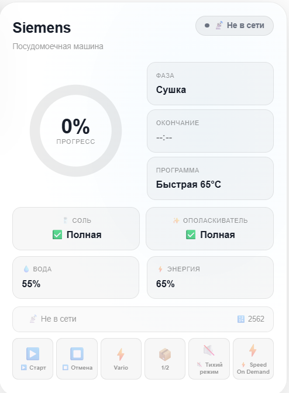
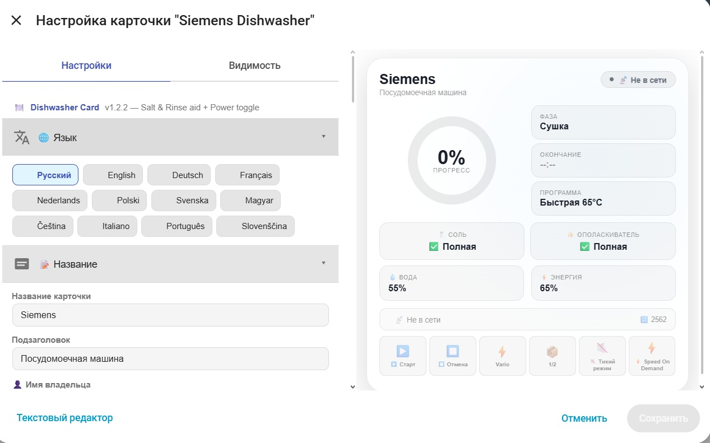

# HA Dishwasher Card

[](https://github.com/hacs/integration)


Пользовательская карточка для Home Assistant Lovelace, предназначенная для мониторинга и управления посудомоечной машиной Siemens. Поддерживает отображение прогресса программы, текущей фазы, оставшегося времени, расхода воды и энергии, уровня соли и ополаскивателя, а также полное управление устройством — включение/выключение, запуск/остановка программ, переключение режимов (VarioSpeed, половинная загрузка, Silence, Speed).

**Не требует дополнительных плагинов. Работает автономно, полностью настраивается через встроенный редактор UI.**

---

## 📸 Превью

<div style="display: flex; gap: 10px; flex-wrap: wrap;">
  
  
</div>

---

## 🎛️ Визуальный редактор



---

## ✨ Возможности

### 🎨 Отображение и интерфейс
- 🍽️ **Основной экран** — название, подзаголовок, персонализированное приветствие
- 📊 **Прогресс-кольцо** — визуальное отображение выполнения программы
- 📋 **Информационные карточки** — текущая программа, фаза, время окончания
- 🧂 **Уровень соли и ополаскивателя** — цветовая индикация (полно/почти пусто/пусто)
- 💧 **Расход воды и энергии** — прогнозируемое потребление в процентах
- 🚪 **Индикация открытой двери** — визуальное предупреждение
- 💦 **Низкое давление воды** — индикация проблемы
- 🚨 **AquaStop** — индикация срабатывания защиты от протечек

### ⚡ Управление
- **🔘 Включение/выключение** — клик по статусу в заголовке
- **▶️ Запуск программы** — кнопка Start
- **⏹️ Остановка программы** — кнопка Abort
- **⚡ VarioSpeed** — ускорение программы
- **📦 Половинная загрузка** — режим для малого количества посуды
- **🔇 Silence** — бесшумный режим
- **⚡ Speed** — режим быстрой мойки

### 🎨 Визуальная настройка
- **6 готовых градиентов фона** — Default, Night, Ocean, Deep Neon, Slate, Custom
- **6 цветовых настроек** — Progress, Running, Idle, Error, Accent, Text
- **Настройка прозрачности фона** — от 0% до 100%
- **Настройка размытия фона** — от 0px до 30px

### 🖱️ Взаимодействие
- **📊 Клик по статусу** — включает/выключает питание
- **🔄 Кнопки управления** — запуск, остановка, переключение режимов
- **📈 Автоматическое обновление** — данные обновляются каждые 30 секунд

### 🌐 Поддержка языков (12 языков)
- 🇬🇧 English / 🇨🇿 Čeština / 🇩🇪 Deutsch / 🇫🇷 Français
- 🇮🇹 Italiano / 🇭🇺 Magyar / 🇳🇱 Nederlands / 🇵🇱 Polski
- 🇵🇹 Português / 🇷🇺 Русский / 🇸🇮 Slovenščina / 🇸🇪 Svenska

### 🔄 Дополнительные функции
- **📱 Адаптивная верстка** — корректное отображение на мобильных устройствах
- **🌙 Три темы оформления** — Auto, Light, Dark
- **📊 Статус-бар** — отображение оставшегося времени и количества запусков
- **🎯 Локализация программ и фаз** — поддержка переводов для всех режимов

---

## 📦 Установка

### Способ 1 — HACS (рекомендуется)

**Шаг 1:** Добавьте пользовательский репозиторий в HACS:

[](https://my.home-assistant.io/redirect/hacs_repository/?owner=ananyevgv&repository=ha-dishwasher-card&category=plugin)

> Если кнопка не работает, добавьте вручную:
> **HACS → Панель → ⋮ → Пользовательские репозитории**
> → URL: `https://github.com/ananyevgv/ha-dishwasher-card` → Тип: **Панель** → Добавить

**Шаг 2:** Найдите **HA Dishwasher Card** → **Установить**

**Шаг 3:** Жёстко обновите браузер (`Ctrl+Shift+R`)

---

### Способ 2 — Ручная установка

1. Скачайте [`ha-dishwasher-card.js`](https://github.com/ananyevgv/ha-dishwasher-card/releases/latest)
2. Скопируйте разархивированные файлы архива в `/config/www/ha-dishwasher-card`
3. Перейдите в **Настройки → Панели → Ресурсы** → **Добавить ресурс**:

| Параметр | Значение |
|----------|----------|
| URL | `/local/ha-dishwasher-card.js` |
| Тип ресурса | `JavaScript Module` |

---

## 🚀 Примеры использования

### Полная конфигурация
```yaml
type: custom:dishwasher-card
title: Siemens
subtitle: Посудомоечная машина
owner_name: Smart Home
language: ru
theme: auto
power_entity: switch.siemens_dishwasher_power
door_entity: binary_sensor.siemens_dishwasher_door
program_entity: select.siemens_dishwasher_selected_program
default_program_entity: select.siemens_dishwasher_default_program
program_phase_entity: sensor.siemens_dishwasher_program_phase
program_progress_entity: sensor.siemens_dishwasher_program_progress
remaining_time_entity: sensor.siemens_dishwasher_remaining_program_time
end_time_entity: sensor.posuda_time_end
start_count_entity: sensor.siemens_dishwasher_start_count
water_forecast_entity: sensor.siemens_dishwasher_water_forecast
energy_forecast_entity: sensor.siemens_dishwasher_energy_forecast
salt_entity: sensor.siemens_dishwasher_salt
rinse_aid_entity: sensor.siemens_dishwasher_rinse_aid
water_pressure_entity: binary_sensor.siemens_dishwasher_low_water_pressure
aquastop_entity: binary_sensor.siemens_dishwasher_aquastop_occurred
start_button_entity: button.siemens_dishwasher_start
abort_button_entity: button.siemens_dishwasher_abort
variospeed_entity: switch.siemens_dishwasher_variospeedplus
half_load_entity: switch.siemens_dishwasher_half_load
silence_entity: switch.siemens_dishwasher_silence_on_demand
speed_entity: switch.siemens_dishwasher_speed_on_demand
